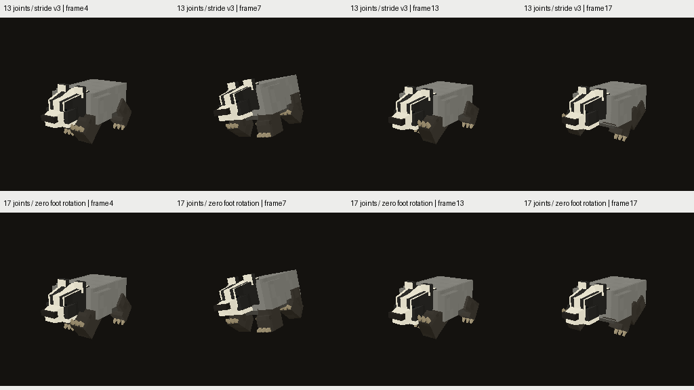
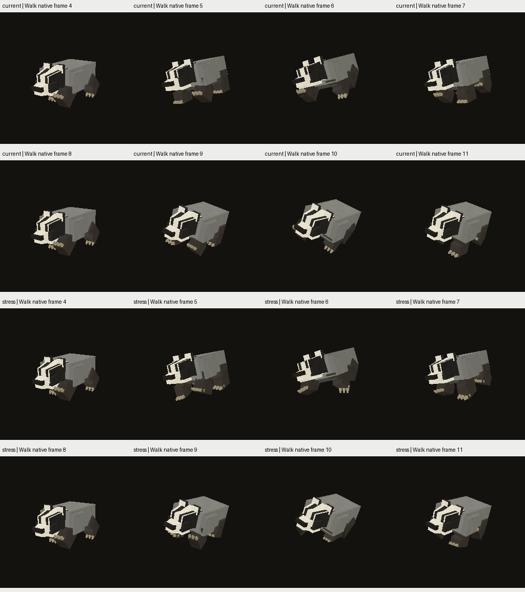

# Badger: контроль дополнительной артикуляции стоп

2026-11-12. **Scratch, не принятый rig и не исправленная походка.**
Источник — `badger_stride_v3`, также unpublished. Новые четыре сустава
`foot_fl/fr/bl/br` сохраняют исходные 13 костей, дают17 joints,360 triangles.
Support-articulation pivot Y0.5 — пробная точка низкополигональной лапы,
не утверждённое анатомическое положение голеностопа.

## Нулевой контроль

`tools/research/build_creature_badger_ankle_control.py`: geometry positions,
indices, UV/PNG и исходные motion channels сохранены. Нижняя поверхность лапы
получает веса foot joint, верхняя — lower joint, когти целиком foot joint.
При нулевом foot rotation эти skin transforms совпадают математически.
В bind и257 фазах каждого Idle/Walk/Run/Action максимальная разница vertex
2.22e−16 model. BIN137200→137456B, без добавленной геометрии/texture atlas.
Это identity control, не проверка ненулевого сгиба или performance.

Оба native captures выполнены последовательно через `flight_sim_run.py`,
Release `7e7f668f…`, одинаковый fixed world `CreatureQaPerf_HintV1`,8s,
одинаковые shaders/camera/native matrix, natural population выключена в обоих
QA каталогах. Production runtime и канонические assets не менялись.

**Exact RGBA проверка не прошла.** Из89PNG86 exact; в3 изменились суммарно5
pixels:3pixels ordinary Walk(max channel delta3), по1pixel в top-view color и
silhouette(max delta255). На просмотренном листе заметной смены формы нет,
но это не право объявить RGBA exact. [Pixel differences](pixel_differences.json),
[metadata/resource/freshness и разрешённая ревизия badger](native_differences.json).
Причина различий между численно эквивалентными skin chains ещё не доказана;
малое количество pixels само по себе не доказывает безопасность всех поз.

[Khronos](khronos/summary.json):35 glTF assets,0errors/0warnings. Это структурная
проверка, не artistic/animation acceptance. Source proposal report остаётся
в `assetgen_output/creatures/badger_ankle_control_v1/proposal_report.json`.

## Ненулевой stress fixture

`build_creature_badger_foot_stress.py` создаёт отдельный **diagnostic-only**
каталог с foot rotations X±30°/Z±20° в Walk. Root correction остаётся прежней:
этот стресс не предназначен для locomotion/world support и не проходит
автоматически floor gate. Idle/Run/Action не меняются.

Просмотрены полные native Walk frames4…11 и3×nearest crop6/10. Дополнительная
артикуляция реально поворачивает подошвы/когти, форма нижнего блока заметно
меняется. Грубого разрыва ноги на этих ракурсах не видно; volume, attachment
seams, допустимый foot range и другие ракурсы ещё требуют проверки. Когти
получают другие веса, чем соседняя поверхность стопы: проверить их attachment
при сгибе, не переносить binding автоматически в production. Добавленная кость
и нулевой контроль сами по себе не означают улучшения скелета.

## Дальше

[Reach analysis](../badger-support-reach-v1/README.md) показал, почему нужны
отдельные hip/upper-body controls или другая постановка опоры. Следующий
scratch `badger_hip_control_v1` сохраняет upper-body roll20° и ограничивает
пробный hip roll8°, без IK. После его geometry/motion/native проверки —
stance-aware solver с joint limits/pole/anchor/release, проверка деформации,
затем actual-world drift на нескольких скоростях и turns/terrain/Run.

Observer v2 пока знает только rigid13-joint badger. Для нового rig он мог бы
записать верх лапы вместо всей поверхности. Wrapper теперь **отклоняет** такой
`--foot-probe` до запуска flight; [guard](observer_guard.json) проверен.
До расширения observer на subtree/blended support нельзя использовать его
данные для17/19-joint контакта. Прямой env запуск старого C++ observer тоже
не даёт достоверного articulated-foot измерения.

Все61 R6 pending, goal active; production resources не опубликованы/не заменены.
Другие56+5/B/R/G, compatibility/FP/UI-pack/control/Android/package и bounds
FAIL17 остаются частью цели.

Обновление: observer v3 уже реализован и проверен на13/19-joint pilots; описанный
выше v2 rejection — исторический результат. [V3 и regression](../foot-probe-v3-runtime/README.md).
