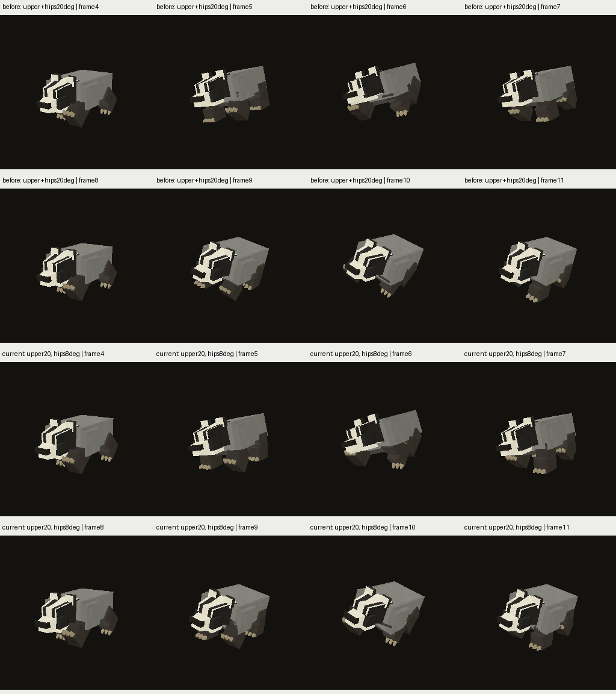

# Badger: раздельные hip / upper-body controls

2026-11-12, goal active. **Unpublished scratch**, без foot locking/IK.
Сохраняет выразительное slow покачивание верхней части корпуса вместо
автоматического уменьшения всей анимации ради flat-foot теста.

## Реализация и проверка

Источник —17-joint `badger_ankle_control_v1`, происходящий от scratch stride v3.
`build_creature_badger_hip_control.py` добавляет два пустых control joints:
`fore_hip_control` под body и `rear_hip_control` под spine. Верхние кости ног
получают этих родителей; исходные кости/пивоты/геометрия сохранены. Итого19
joints,360triangles, та же128²PNG/UV. Поэтому это осознанная ревизия hierarchy,
не утверждение, что rig побайтово прежний. Добавление суставов ещё не доказывает
улучшение: итоговая деформация и опора остаются предметом приёмки.

В Walk helper rotations компенсируют часть roll только для ног: upper-body
±20° остаётся, target hip roll±8°. Rear compensation учитывает spine yaw в
его локальном basis, а не вычитает Euler Z вслепую.333keys/control. В остальных
clips helpers identity. Новая root Y запечена адаптивно по full skinned mesh,
1344keys; Generic CreatureGen не менялся. BIN150616B против137456B source17
и137200B stride13. Memory/load/performance нового rig ещё не измерены.

[Независимый exported audit](invariants.json):

- Все прежние local rotation channels/input/output arrays exact; дополнительные
  только два Walk helper tracks. Старые bind world matrices exact.
- Geometry positions/indices, UV, weights и PNG exact к17-joint контролю.
- На1025 фазах world rotations body/spine/head/jaw/tail exact; максимальная
  ошибка fitted hip orientation относительно target0.000596°.
- На8193 экспортированных Walk phases floor0.00000750…0.00043486 block,
  в прежних±0.001. Это sampled global minimum, не terrain/footplant guarantee.
- Builder отдельно проверил bind и65 фаз каждого Idle/Run/Action: posed vertex
  difference0. Recipe/root fit hashes —в scratch proposal_report.json.

[Khronos](khronos/summary.json):35assets,0errors/warnings.

## Native renderer

Просмотрены8 Walk phases до/после: общий выразительный наклон туловища/головы
сохранился, лапы меньше следуют боковому перекату. Root Y тоже пересчитана,
поэтому экранное положение корпуса в фазах меняется. На этих ракурсах явного
разрыва крепления ног не видно; задние/нижние ракурсы и переходы ещё нужны.
Превью не доказывает контакт при движении или качество всех joint limits.

Последовательный Release flight через `flight_sim_run.py`, EXE7e7f668f…,
fixed world `CreatureQaPerf_HintV1`,8s, те же shaders/camera/matrix. В этом
flight **не было** `land_walk_pause` и foot observer; world служил запуску
native exports, а не измерению stance. Renderer comparison:
[metadata/freshness/resources](native_differences.json),
[все21 ordinary non-Walk кадр RGBA exact](non_walk_native.json).
Walk pixels намеренно изменены; это не exact-parity gate всего badger.

## Следующий код, критерии и ограничения

1. Для этого19-joint rig решить leg chain upper→lower→foot с сохранёнными
   lengths и заранее заданными stance/swing anchors. Начать с того же
   диагонального шага для сравнения; не объявлять его утверждённой биологией
   walking badger. Отдельно проверить необходимость four-beat gait.
2. Выбирать root Y из пересечения достижимых интервалов опорных ног; проверить
   geometry/ground и избежать knee singularities. Выбор внутри reach interval
   — лишь необходимое условие; hip/foot limits и preferred knee pole обязательны.
3. Считать knee/upper rotations из позиций hip/knee/foot; foot local quaternion
   получать из desired world foot orientation и фактического lower parent.
   Не двигать foot mesh отдельной translation и не растягивать кости.
4. Flat middle stance, затем heel/toe release/plant; плавные swing и периодические
   seams. Сохранить upper-body rhythm отдельно. Проверить skin volume и связь
   когтей с лапой: текущий stress использует иные weights для когтей, чем для
   соседнего foot block; attachment ещё не принят.
5. Проверить exported sampled poses/limits/clearance, native multi-view/transition
   sheets, затем расширить observer на полный lower-foot subtree и blended skin.
   Старый v2 rigid13 observer непригоден, wrapper его блокирует для нового rig.
6. Actual-world несколько скоростей/stop/turn/terrain/Run, независимые опорные
   окна и world XZ drift, затем costs/family budgets, review/publication и полная
   regression. Свежий skin экспорт или достижимость не заменяют art acceptance.

R5 production56+5 не заменены, все61 R6 pending. Другие пилоты/B/R/G, bounds17,
GPU/frame noise, memory/load, FP/compatibility/UI-pack/control/Android/package
сохраняются в общей цели.
