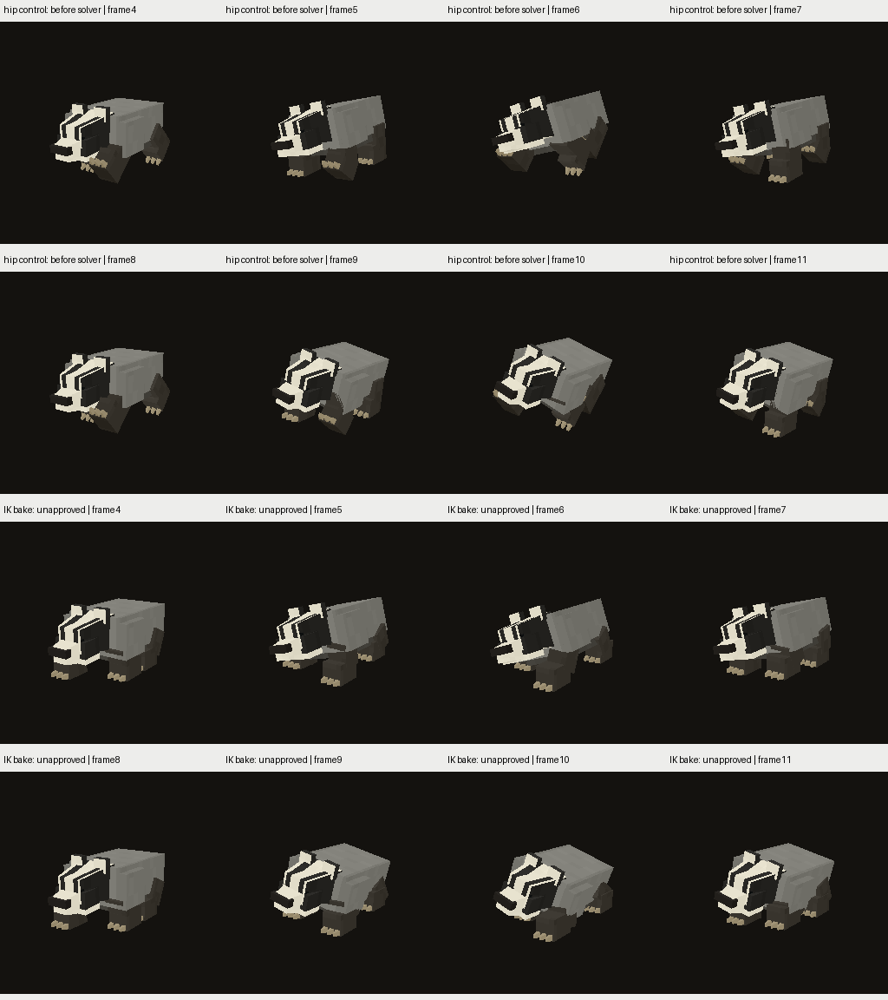
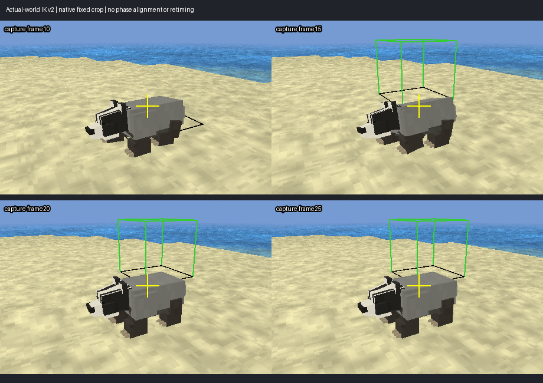

# Badger: опорный Walk bake и проверка в мире

2026-11-12. Goal active, все61 R6 pending. **Эксперимент unpublished**: канонические
recipe/staging/bin models не заменены. Это запечённая походка для плоской
поверхности, не runtime terrain IK и не завершённая художественная приёмка.

## Реализация

`tools/research/build_creature_badger_stance_ik.py` использует19-joint hip-control
rig. Сохраняет slow upper-body20°/hip8°, source head/spine/tail и остальные clips.
Upper/lower/foot rotations Walk решаются по заданным до измерения стойкам:
диагональные пары, duty50%,14strides/macroloop, неизменные длины костей,
preferred knee pole−Z, горизонтальная средняя опора и плавный swing/pitch.
Root выбирается из общего допустимого reach interval, без растяжения ног.

Длина шага выводится из **definition walk_speed/model_scale/clip speed**, не из
подгонки к полученному drift. Nominal travel3.666667 model/asset-second,
stride≈0.513333model. Contract сохранён в scratch `support_contract.json`, hash
привязан к [world_support.json](world_support.json).1025keys/track,1025 rootkeys.
BIN373432B против150616B hip-control: memory/load/CPU/GPU budget **не принят**.
Generic CreatureGen пока не менялся; этот prototype нельзя выдавать за общий
генератор для всех56+5/B/R/G.

### Неудачный первый bake сохранён

`assetgen_output/creatures/badger_stance_ik_v1/rejection.json` и первый полный
лог: кинематически достижимые суставы не гарантировали хороший mesh. Верх
`foot_fl` оставался связан с lower, низ — с foot, поэтому весь блок лапы сминался
и уходил под землю (полный8193-sample замер требовал бы root lift≈0.05926block).
Повторная диагностическая запись сохранила конкретную вершину/фазу и остановилась
раньше после уверенного нарушения. Предел±0.001block не менялся, подъём всей
модели для сокрытия дефекта отклонён.

Во v2 семантическая **целая лапа и её когти жёстко привязаны к foot joint**.
Это сохраняет их объём/UV и взаимное крепление при вращении. Исходные geometry
positions/indices/PNG и19-joint hierarchy/bind сохранены, изменены веса только
лап. Никакого уменьшения mesh/atlas для прохождения проверки.

## Независимый экспортированный audit

[kinematics.json](kinematics.json),2049phases:

- Положение опорной точки XZ отличается от заданного≤0.000404block; offline
  nominal plant endpoint drift≤0.000254block, orientation error≤0.02138°.
- Bone lengths error≤9.72e−17model; all original upper-body/other-clip channels
  exact. Веса вне лап exact; каждая лапа и когти имеют один rigid transform.
- Верхняя кость ноги и rigid paw box пересекаются во всех проверенных фазах:
 0разъединений по15-axis OBB SAT. Это соединение через пересечение кубов,
  **не** доказательство watertight mesh или отсутствия лишних пересечений.
- Knee max stance85.51°, swing128.51°; foot local rotation до102.84°.
  Hip/foot limits ещё не прошли художественную/анатомическую оценку. Числа
 5…120 stance /5…155 swing — параметры пилота, не общий species contract.
- Builder8193 exported floor samples после measured global lift0.00100027model:
  gap0.0000075…0.00075021block; независимый2049-sample audit согласуется.
  Lift исправляет sub-mm sparse-key undershoot, не59mm дефект первого варианта.

[Khronos](khronos/summary.json):35assets,0errors/warnings. Это не art acceptance.

Просмотрены8 native Walk phases до/после: корпус сохраняет характерный наклон,
лапы устойчивее направлены к земле. Плоская опора делает шаг более собранным;
нужен ещё shared-scale original/current review и оценка heel/toe roll, чтобы
не получить механический trot вместо подходящей badger походки.
[Все21 non-Walk ordinary PNG exact](non_walk_native.json). Первый native sheet
получен на прежнем Release7e7f668f…; реальные world captures ниже — на30714e….
Сами runtime связаны full5290/936 exact regression, assets не пересохранены.
Дополнительно [все29 ordinary кадра самого19-joint prototype exact](runtime_preview_bridge.json)
между7e7f… observer-off и30714e… observer-on/world-driver окружениями. Это мост
только29кадров, не60-image matrix или совпадение world camera frames.

## Обычный motor в реальном мире

Три последовательных20s flights через `flight_sim_run.py` на Release
**30714e6226629f931ca35259bc440011ca1220a7c7544295847f44cc5f628e52**:
live13, hip-control19, IK19. `CreatureQaPerf_HintV1`, flat ground, close camera,
одинаковый QA driver `land_walk_pause`: intent, ordinary motor/state derivation,
без подстановки фактов/clip/position. Natural population выключена одинаково.
Steady speed≈0.475block/s; [measured clip rate≈0.176](clock_observation.json).
В driver records нет frozen/body_blocked; world startup/process success проверены.

Observer v3 наблюдает фактически submitted palette/body matrix и всю semantic
lower-foot subtree. Полнота bind positions/skin weights/joint membership
**независимо сверена с glTF** для каждого из этих трёх каталогов. Он сохраняет
same-position points с разными skin weights. Это CPU shader-equivalent world
observation, **не GPU readback**, plane —actor feet Y, не отдельный terrain query.
Покрываются vertices wholly weighted к subtree, не любой возможный future skin.

Предопределённые inner stance windows: исходные live/hip0.55…0.95 своего stride
(по source lower-flex фазам), новый contract0.05…0.45. Все fixed bind-bottom
points, без отбора по полученной скорости/высоте. Episode≥3frames/0.1s и actor
displacement≥0.025; warmup/fades/резкий yaw/frame gaps исключены.
Точки одной лапы коррелированы, counts не равны независимым footfalls; это один
маршрут, не confidence bound всех будущих запусков. Диагональные height curves
на графике перекрываются, поскольку пары идут в одной фазе.

| Измерение | Live13 | Hip19 без IK | IK19 |
|---|---:|---:|---:|
| Steady Walk records |507|483|474|
| Point episodes |240|400|400|
| Median XZ foot/body ratio |0.07875|1.19640|**0.01931**|
| Median foot displacement,block |0.02050|0.16535|**0.00272**|
| Median bottom-point height,block |0.05910|0.06160|**0.000732**|
| Maximum bottom-point height,block |0.17896|0.21939|**0.000751**|

Малый live phase ratio **не** доказывает хороший footplant: большая часть этих
bottom points в воздухе, естественный heel/toe roll тоже не требует неподвижности
всех углов подошвы. Дополнительные height-only candidates при threshold0.01 дают
ratio median live0.8521 /hip0.6994 /IK0.0813; при0.03 —0.9655/0.6781/0.2796.
Height-only выборка включает swing points и не заменяет опорные labels.
Negative control +2×actorXZ drift, те же labels/heights: IK ratio0.01931→1.98069.

Просмотрены4 native frames, фиксированный crop без retiming/phase alignment.
Лапы визуально стоят устойчивее, torso/head identity сохранены. Этот результат
доказывает прогресс только на указанном fixture; foot clipping на рельефе,
turns/start-stop/fades/action/Run и художественная оценка ещё открыты.

## Следующий этап

Остаток≈1.9% согласуется с текущим runtime speed floor: nominal gait при
measured rate0.176 соответствует0.484block/s, actor≈0.475. В
`CreatureVisualGltf.cpp` travelScale<0.04 обнуляется, иначе минимум0.22.
Нельзя объявлять distance sync для других медленных скоростей или поворотов.

Далее: явный distance-synchronized режим для support gait без глобальной
смены legacy playback; проверки нескольких скоростей/паузы/фаз/retained fades,
затем turns/terrain normals/steps/slopes/Run/action. Отдельно оценить нужность
four-beat gait и heel/toe roll, joint limits/объём/силуэт против оригинала.
После performance/memory/load budgets и художественного решения — перенос
контракта/solver в CreatureGen с параметрами семейств, source freshness/reviews,
и проверка cow B /badger G /rigid_demo_walker R. Остальные пилоты/56+5 и полный
R6 scope сохранены. Ни успешный bake, ни этот один world маршрут не дают R6.

[Default-off runtime regression и известный неверный catalog run](../foot-probe-v3-runtime/README.md).
