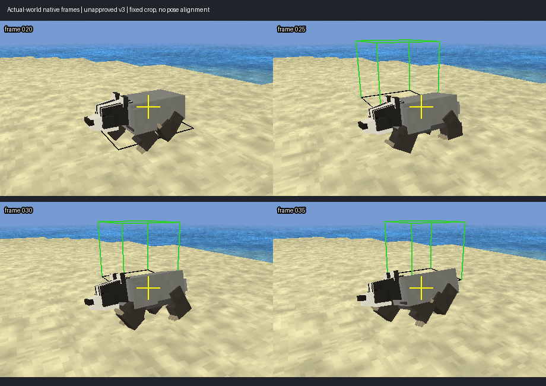

# Badger: реальная частота и опора лап, 2026-11-12

Цель active. Вариант `badger_stride_v3` — **неопубликованный эксперимент**,
не прошедшая R6 модель. Все 61 R6 pending. Канонические recipe/staging/bin
ресурсы badger не заменены. Проверка объяснила, почему сохранение старого
elapsed cadence само по себе не гарантирует сохранения качества походки.

## Что наблюдали

Новый opt-in `CreatureQaFootProbe.h` наблюдает CPU-позиции реально поданной
palette/root после постановки body draw в очередь. Преобразование повторяет
skin/body цепочку shader. Наблюдатель не меняет pose, clock, motor или physics.
`--foot-probe` допускается только для badger / `land_walk_pause`, без timing.
Это не GPU readback и не запрос поверхности terrain: плоскость — actor feet Y.

В observer v1 нижняя bind-плоскость не включала приподнятые когти. Из-за этого
он пропускал реальные самые низкие вершины. Исторические записи сохранены в
`../badger-stance-v1`, для вывода об опоре их не использовать. Observer v2
включает **все фиксированные rigid lower-foot surface points**, в том числе
когти; анализ проверяет совпадение их минимума с полным обходом foot vertices.
Не переносить этот частный rigid badger detector на произвольный blended skin.

Release SHA `7e7f668f440e3a678e548c06f8dba021ed6fde99ce67e5eb43fc1d223d002859`.
World `CreatureQaPerf_HintV1`, обычный motor Walk/pause, flat ground, fixed noon/
clear weather. Две серии observer v2: live / sway v2 в `../badger-stance-v2`,
live / stride v3 здесь. Baseline здесь — проверенная копия предыдущей записи;
[reference_reuse.json](reference_reuse.json) фиксирует происхождение.
Новый capture current — 20 s через `flight_sim_run.py`. Capture/observer IO
неодинаковы между сериями, **никаких performance выводов из этих записей**.

## Что изменил эксперимент

Live recipe: nominal unit-travel stride 0.35 s, но при actual speed ≈0.475
blocks/s и walk_speed=2.2 фактический clip rate ≈0.176, stride **1.591 s**.
Тело проходит за него ≈0.756 block. Preview unit travelScale скрывал это.

Builder `tools/research/build_creature_badger_stride_pilot.py` берёт scratch
sway v2 и удваивает только Walk leg cadence: 7→14 strides на прежний macroloop.
Форма каждой 9-key угловой фазы сохранена. Медленные корпус/head/tail/spine
прежние; Run/Idle/Action не меняются. Generic CreatureGen не изменён.
Walk root Y явно запечён адаптивно по полному skinned mesh: 1362 keys,
fit tolerance 0.0002 model, измеренный safety lift, C0 seam. Попытка 0.00005
и попытка изменить Run превысили 2049 keys; их логи сохранены как неуспехи.
Допуски приёмки ради прохождения не расширены. Run остаётся отдельной задачей.

[Независимый audit экспортированных данных](invariants.json): rig/hierarchy,
inverse bind, все mesh attributes/indices, skin weights, UV и PNG exact;
Run/Idle/Action и остальные Walk channels exact; удвоенная leg phase shape
exact; сохранённый recipe воспроизводит glTF semantic/BIN bytes.
8193 **экспортированных** Walk samples: floor 0.00000750…0.00045850 block,
в пределах прежних ±0.001. Это sampled clearance, не аналитическая гарантия
между всеми sample times и не stationarity опорной стопы.
BIN 135136→137200 bytes относительно sway v2; memory/load/performance v3
не приняты. [Khronos](khronos/summary.json): 35 assets, 0 errors/warnings.

## Результат движения и визуальный просмотр

Просмотрены четыре native кадра реального движения с одинаковым crop; камера
не выравнивалась под позу. Диагностические bounds/crosshair оставлены.
Модель сохраняет исходные короткие лапы/полосатую морду и объём sway v2,
но корпус заметно перекатывается, отдельные лапы высоко уходят от плоскости.
Статичные кадры не доказывают хороший контакт или отсутствие скольжения.

[Stance audit](stance_audit.json) использует **кандидаты контакта по высоте**,
не утверждённые footplant labels. Фиксированные surface points, episode≥3
кадров/0.06 s, actor displacement≥0.025 block; исключены fade, крутой yaw,
gap>0.1 s, стартовый warmup. Точки одной лапы коррелированы, количества episodes
не считать независимыми footfalls. Ratio — endpoint XZ displacement foot/body.

| Измерение | Live | Stride v3 |
|---|---:|---:|
| Реальный stride, s |1.59091|0.79545|
| Median ratio, height≤0.01 |1.2266|1.2099|
| Median ratio, height≤0.03 |1.0963|0.6829|
| Median ratio, height≤0.05 |0.9273|0.8016|

У sway v2 median ratio при 0.03 был 0.7384. Ускорение шага помогает части
кандидатов, но устойчивого footplant не создаёт: узкий 0.01 threshold почти
не улучшился. Порог высоты меняет состав выборки. Synthetic negative control
с добавлением 2× actor XZ drift повышает median ratio 0.6829→2.4982 при тех же
высотах: detector чувствителен к скольжению. Это не оценка качества IK.
**Art/stance acceptance остаются pending. Удвоение частоты не публиковать.**

## Следующая реализация и условия переноса в генератор

1. Описать независимо проверяемые stance/swing phase curves и semantic support
   anchors каждой лапы; отдельно heel/toe/claw roll и смену опоры. Не выбирать
   только уже неподвижные точки из candidate, чтобы затем объявить их успехом.
2. Согласовать длину шага и частоту с actual motor travel; сохранить slow-body
   macroloop отдельно. Проверить несколько Walk speeds, старт/паузы/разворот,
   затем отдельный Run route. Не фиксировать одну частоту всем существам.
3. На scratch badger проверить stance-aware solve: world-space опорный anchor,
   ограниченные суставы и достижимость цепи, стабильная сторона сгиба, плавный
   release/plant. Сохранять hierarchy/weights/длины костей и соединения сегментов.
   Не приклеивать foot mesh отдельной translation ценой разрыва ноги. Root Y
   clearance решает только вертикальную оболочку, не world XZ foot lock.
4. Ввести измерение drift в **заранее заданных** опорных окнах; сравнить live,
   sway v2 и solver на одном обычном motor fixture. Затем terrain normals,
   уклоны/ступени, turns, stop, fades и action; визуальные native clips обязательны.
5. После удачного пилота переносить contract/solver в CreatureGen с family
   параметрами, budgets, source freshness/review/publication и полной регрессией.
   Изменение generic generator требует обновления provenance всех затронутых
   assets. Сохраняются treeman/puffin, остальные 56+5 и B/R/G, UI/control,
   FP/compatibility/Android/package и открытый bounds FAIL17.

Основание: [Kovar/Schreiner/Gleicher, Footskate cleanup](https://graphics.cs.wisc.edu/Papers/2002/KSG02/)
рассматривают footplant constraints; [Epic Speed Planting](https://dev.epicgames.com/documentation/unreal-engine/fix-foot-sliding-with-ik-retargeter-in-unreal-engine?lang=en-US)
использует foot speed curves и IK goals/solvers. Вывод для Cubatarium — наша
инженерная адаптация, не утверждение, что здесь уже реализован Epic pipeline.

## Регрессия runtime при выключенном observer

[Production](../badger-stance-v2/production/) на текущем Release против
1507b3…: **5290 body и936 authored FP RGBA exact**, body/context/resources
проверены `body_parity.json`, отдельный результат `fp_exact.json`.
FP native audit:1872 GPU draws/6 retained cases; save128cases/256loads PASS.
[15 targeted Release tests](../badger-stance-v2/release_tests.log) PASS.
[Ledger](ledger_after.json):61/61 свежих R5, staged/published/bin exact.
Это проверка default-off runtime регрессии; не full R6 acceptance.
