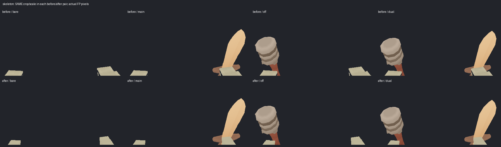

# R6: source-correct FP руки

[Метод, ограничения и следующий save-план](README.md).

| Evidence | Результат |
|---|---|
| [Native FP audit](fp_audit.json) | 936 PNG,1872 source-correct GPU buffers,6 retained-cache cases |
| [Body parity](body_parity.json) | 5290/5290 RGBA всех61 прежние |
| [Release tests](release_tests.log) | 11/11 |
| [Ledger](ledger.json) | 61/61 |
| [Visual review](visual_review.json) | Прямо просмотрены18 paired sheets; принят arm-source subset |

Пары сохраняют crop/scale. Idle показывает четыре loadouts; walk и attack —
полный sampled dual cycle. Верх/before и низ/after. Общее низкое FP framing
и уход руки за экран во время старой атаки остаются видны; полная FP
presentation и world-camera/save приёмки pending.

## human

[Idle](sheets/human_idle_comparison.png) · [Walk8](sheets/human_walk_comparison.png) · [Attack17](sheets/human_attack_comparison.png)

## human_adventurer

[Idle](sheets/human_adventurer_idle_comparison.png) · [Walk8](sheets/human_adventurer_walk_comparison.png) · [Attack17](sheets/human_adventurer_attack_comparison.png)

## human_guard

[Idle](sheets/human_guard_idle_comparison.png) · [Walk8](sheets/human_guard_walk_comparison.png) · [Attack17](sheets/human_guard_attack_comparison.png)

## bot

[Idle](sheets/bot_idle_comparison.png) · [Walk8](sheets/bot_walk_comparison.png) · [Attack17](sheets/bot_attack_comparison.png)

## zombie

[Idle](sheets/zombie_idle_comparison.png) · [Walk8](sheets/zombie_walk_comparison.png) · [Attack17](sheets/zombie_attack_comparison.png)

## skeleton

[Idle](sheets/skeleton_idle_comparison.png) · [Walk8](sheets/skeleton_walk_comparison.png) · [Attack17](sheets/skeleton_attack_comparison.png)

Body original/current sheets: [bone-motion](../bone-motion/index.md), [equipment](../equipment-fit/index.md).
Цель активна; полная R6 pending.

Следующий выполненный entity save/load этап: [save-roundtrip](../save-roundtrip/index.md).
Полный world/user/FP save gate остаётся pending;17 bounds/contact mismatches отмечены явно.
