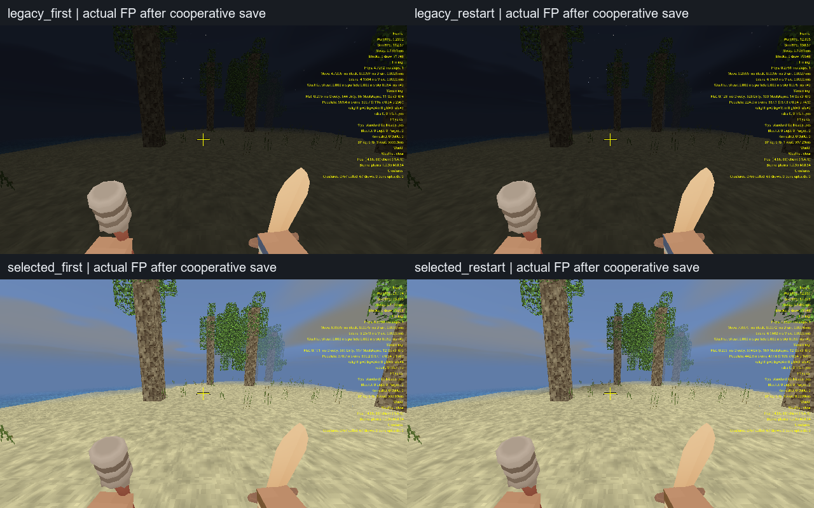

# R6: user/world save и реальный idle FP

Четыре Release процесса: legacy appearance и selected skin до/после рестарта.
Actual user inventory/6armor/offhand и64 NPC сохраняются,20 control roundtrips
проходят. Full R6 pending;17 bounds/contact mismatches остаются открыты.

[Метод, ограничения и следующий план](README.md).
[Legacy first audit](audit_legacy_first.json),
[legacy restart audit](audit_legacy_restart.json),
[selected first audit](audit_selected_first.json),
[selected restart audit](audit_selected_restart.json),
[disk→restart parity](restart_parity.json).

Текущий EXE: [5290 body RGBA parity](integrated/body_parity.json),
[FP source/GPU audit](integrated/fp_audit.json),
[936 FP RGBA parity](integrated/fp_parity.json),
[entity save audit](integrated/audit_integrated_final.json),
[ledger61](ledger.json), [11 targeted Release tests](targeted_release_tests.log).

[17 bounds discrepancies](../save-roundtrip/bounds_diagnostic.json) и
[полный незелёный CTest](../save-roundtrip/full_ctest.log) остаются видимыми.
Фактические source frames/SHA/timing перечислены в visual_review.json.
