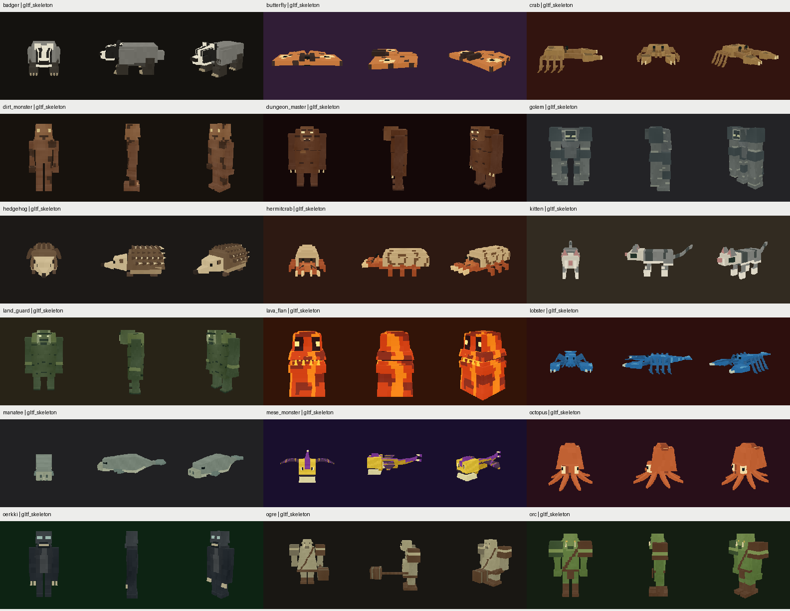
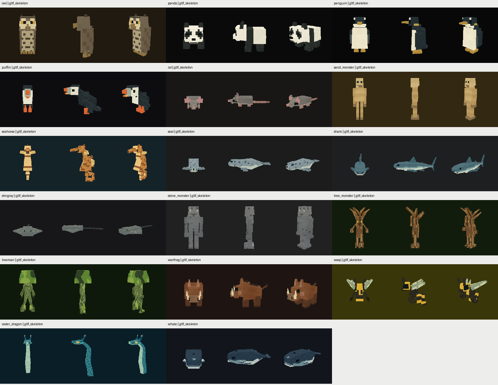
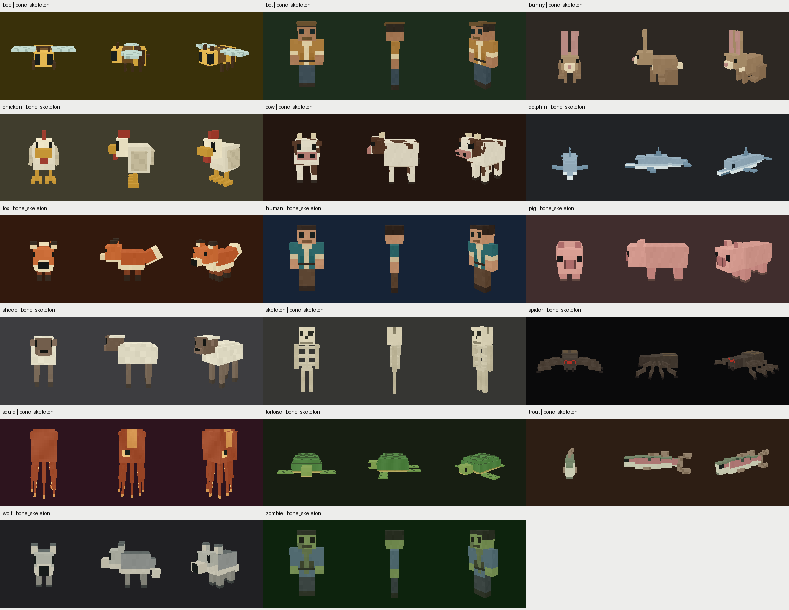
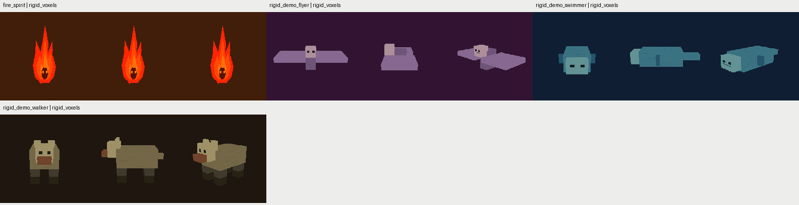
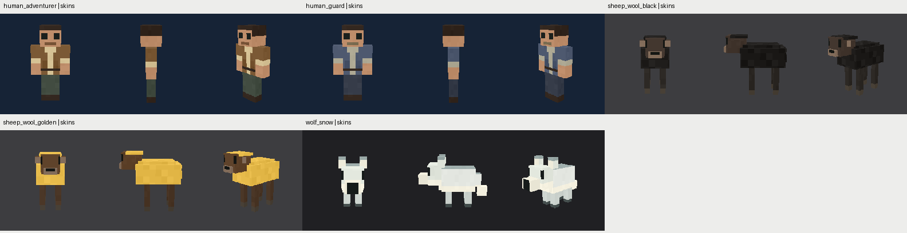

# Выпуск56существ+5скинов — ограниченная цель выполнена

12ноября2026. Выполнен [90-minute план](../../CREATURE_TIMEBOX_RELEASE_PLAN_2026-11-12_RU.md)
по прямому указанию пользователя завершить общий выпуск, а остаточные
шероховатости вынести из текущей цели. Начало07:27UTC, итоговые проверки
завершены08:24UTC: **около57минут**, раньше deadline08:57UTC.

Это согласованный рабочий выпуск всех56species и5skins в `models` и `bin`,
не заявление об окончательной художественной R6. [Backlog последующей доводки](../../CREATURE_RELEASE_BACKLOG_2026-11-12_RU.md)
больше не является условием завершения текущей цели.

## Что применено

- Включены накопленные изменения формы, rig, авторских текстур и материалов
  **всех61 ресурсов**. Для каждого есть реальные visual payload changes
  относительно HEAD, свежая генерация и disposition в [release ledger](release_ledger.json).
  Это объединение уже выполненной переработки, а не искусственная замена всех
  PNG ещё раз в рамках90минут.
- Проверенный19-joint badger Walk перенесён из эксперимента в canonical recipe
  и опубликованные модели. Верхний body motion сохранён, опорная походка и
  rigid paws воспроизводятся генератором; Run/Idle/Action сохранены.
- Генератор настраивает ground-distance playback для26G существ, включая
  наземные состояния crabs/lobster и ground walking owl/puffin. Fly/Swim/Idle
  сохраняют прежнее воспроизведение. У B/R зафиксирован действующий moving
  phase по actual travel, у sprite нет вымышленного footplant. Скины наследуют
  соответствующий clock базового вида.
- Все56+5 пересобраны и опубликованы через отдельный **bounded-release** gate:
  hashes, актуальные sources, native context/images и успешный world smoke
  проверяются до первой записи. Старый строгий R5/R6 review path не ослаблен;
  `published_bounded` не выдаётся за полную R6-приёмку.

Состав:35G,17B,3R+1sprite,5skins. Резервная копия до выпуска находится в
`assetgen_output/creatures/timebox_release_v1_backup`.

## Проверки результата

| Проверка | Результат |
|---|---|
|[Свежая provenance и models/bin payload](release_ledger.json)|61/61|
|[Повторная генерация после публикации](reproducibility.json)|61/61 exact bundles|
|[Native кандидат→опубликованный пакет](published_capture_parity.json)|5290/5290 RGBA exact,61resources|
|[Независимый Khronos](khronos/summary.json)|35glTF,0errors/0warnings|
|[Release build](checks/release_build.log)|PASS, verify-windows-exe PASS|
|[Свежие/целевые C++ проверки](checks/cpp_tests.log)|5/5 PASS|
|[Python quality/fidelity](checks/python_tests.log)|46/49PASS;3 известных остатка в TEST-01|
|[Повтор этих3 на recipe из backup](checks/python_backup_failures.log)|Те же3 failures, не введены этим выпуском|
|[FP native smoke](production/fp_audit.json)|936frames,1872authored GPU draws,6retained cases PASS|
|[Entity save/load smoke](production/audit_published.json)|128cases/256loads PASS|
|[Cow B /badger G /rigid walker R в мире](world_smoke.json)|3/3 process success, ordinary grounded Walk и pauses|

Desktop собирался толькоRelease точной командой AGENTS.md; все запуски
Cubatarium —через `flight_sim_run.py`. EXE SHA:
`6a997c20969b72006636ed7c5cd9a5c035ac5d55bee224bff49e2bfb1537bd57`.
Полный CTest не объявляется зелёным; старые bounds findings и3Python residual
tests сохранены отдельно. FP/save/world smoke ограничены указанной матрицей.

## Просмотренные листы всего каталога

Ниже реальные native front/side/three-quarter. Нормализация каждого preview
позволяет проверить читаемость и отсутствие пропавших частей; сама по себе
она не доказывает world-scale fidelity или завершённую индивидуальную R6.
Все61 ресурса просмотрены, индекс и hashes —в [native_visual_index.json](native_visual_index.json).







## Остатки и последующая работа

Основные остатки: индивидуальная художественная доводка, terrain/turn/fade/Run
опора, joint limits/heel-toe, memory/CPU/GPU budgets большого badger bake,
исторические17 bounds findings,3 Python checks, полная FP/control/UI-pack,
user-world/Android/packaging матрица и inactive legacy cleanup. Они перечислены
с ID в [отдельном backlog](../../CREATURE_RELEASE_BACKLOG_2026-11-12_RU.md)
и **исключены из завершённой текущей цели**.

Решение на выпуск —[bounded_release_review.json](bounded_release_review.json).
Повторная публикация неизменённого проверенного состояния:
```powershell
$env:PYTHONPATH='tools'
python -m creaturegen release --review docs/research/creature-timebox-2026-11-12/bounded_release_review.json
```
При изменении sources/payload старый review не подходит: gate требует свежие
bundle/context/image hashes. Строгая полная R6 остаётся отдельной будущей задачей.
