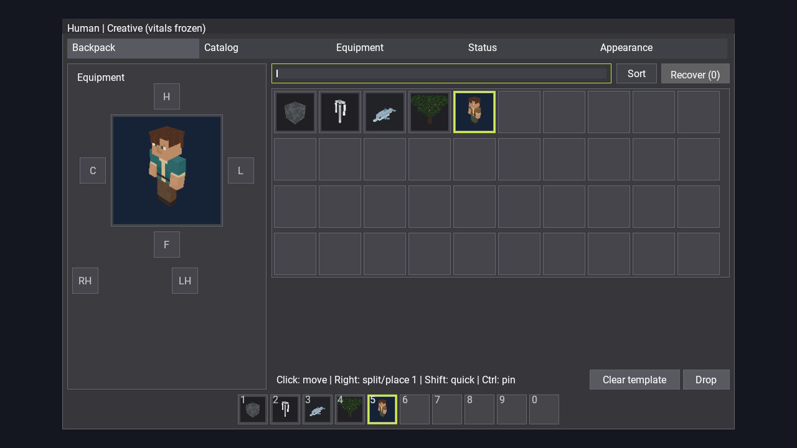

# Иконки всех типов записей инвентаря — 2026-11-14

Исправлено отображение дельфина и остальных существ, объектов и обликов в рюкзаке и разделе восстановления. Эти разделы выбирали иконку блока либо предмета; остальные типы ошибочно попадали в обработчик предметов с кубом-заглушкой.

Общий `IUGuiIconSource::GetEntryIcon` явно обрабатывает Block, Item, Object, UCreature и Skin. Его используют рюкзак, восстановление, нижняя панель общего окна, HUD, переносимый курсором слот и прежние экраны инвентаря. Каталог сохраняет постепенную генерацию и кэширование иконок. Дополнительно зарегистрирована категория `outfits`: пять существовавших обликов ранее не попадали в каталог из-за отсутствующего описания тега.

## Проверки

Команда полного прогона: `python tools/run_items_acceptance.py --extended --world CarryAimQA`. Desktop собран только Release установленной командой; запуск выполнен через `tools/flight_sim_run.py` и `bin/Cubatarium.exe` на отдельном QA-мире.

- 21 CTest — успешно.
- Native: 51 проверка игрового цикла, 57 проверок имущества, 18 проверок ввода, 24 прежних layout-проверки, 72 проверки общего окна и 7 проверок состояния — успешно.
- Новый native-аудит: все 60 объектов, 55 видов существ и 5 обликов активного каталога. Фактические текстуры слотов рюкзака и нижней панели сверяются с независимым выбором специализированного источника иконок.
- Дополнительно проверены пять типов записей вместе, включая дельфина, и те же пять типов в восстановлении, открытом настоящим кликом через InputRouter. Всего 130 проверок иконок — успешно.
- Style, include и clang-format — успешно; новых нарушений зависимостей нет. Существующий allowlist include-аудита сохранён.

Проверяются все доступные записи объектов/существ/обликов активного каталога, а не отключённые дополнительные пакеты. Для блоков и обычных предметов дополнительно проверены представители в смешанных слотах и восстановлении; их специализированные генераторы не изменены. Новые страницы иконок сняты в настоящем Release GUI при 1280×720, масштаб 100%; общая регрессия окна повторила 1280×720 и 1920×1080 при 100/150/200%.

## Доказательства

[Сводный результат](evidence/result.json), [130 проверок иконок](evidence/native.json.icons.json), [размеры окна и сохранение состояния](evidence/native.json.player-window.json), [CTest](evidence/ctest-items.log), [сборка Release](evidence/desktop-release.log), [native-запуск](evidence/native-flight.log), [SHA-256 executable](evidence/executable.sha256).

Все семь страниц просмотрены визуально. Дельфин находится в третьем слоте смешанной страницы и соответствующем слоте нижней панели.

Другие страницы: [существа 1](visual/creatures_0.png), [существа 2](visual/creatures_1.png), [объекты 1](visual/objects_0.png), [объекты 2](visual/objects_1.png), [облики](visual/skins_0.png), [восстановление](visual/recovery.png).
