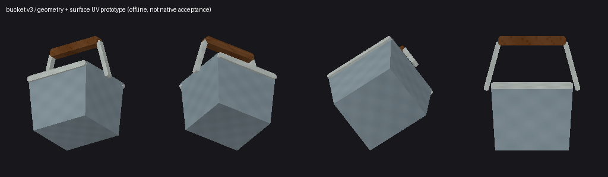
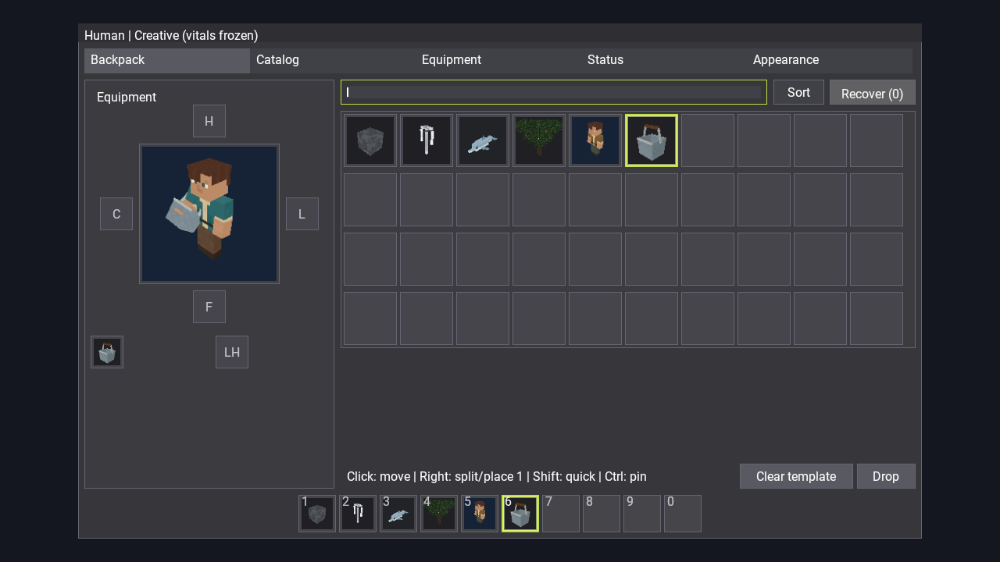
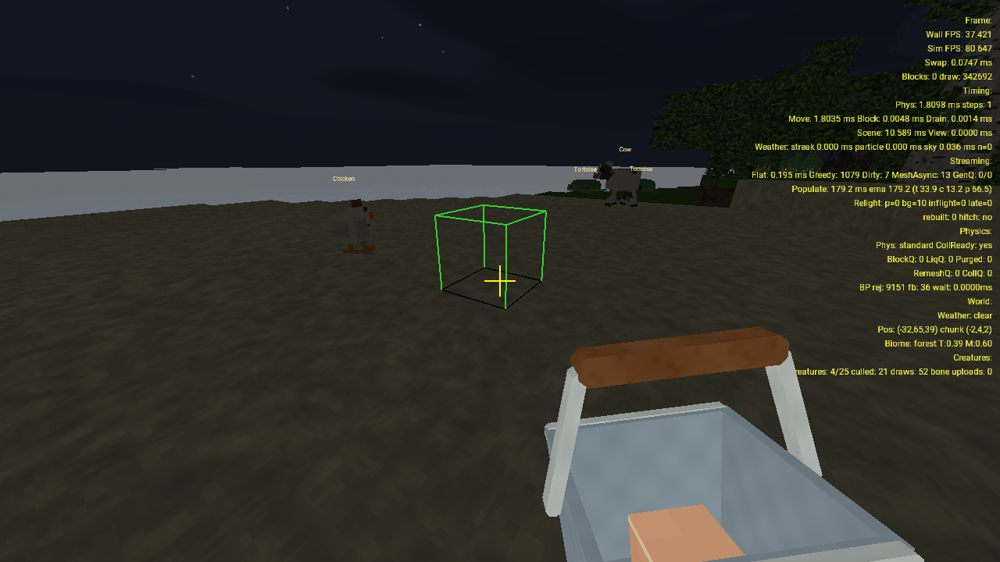
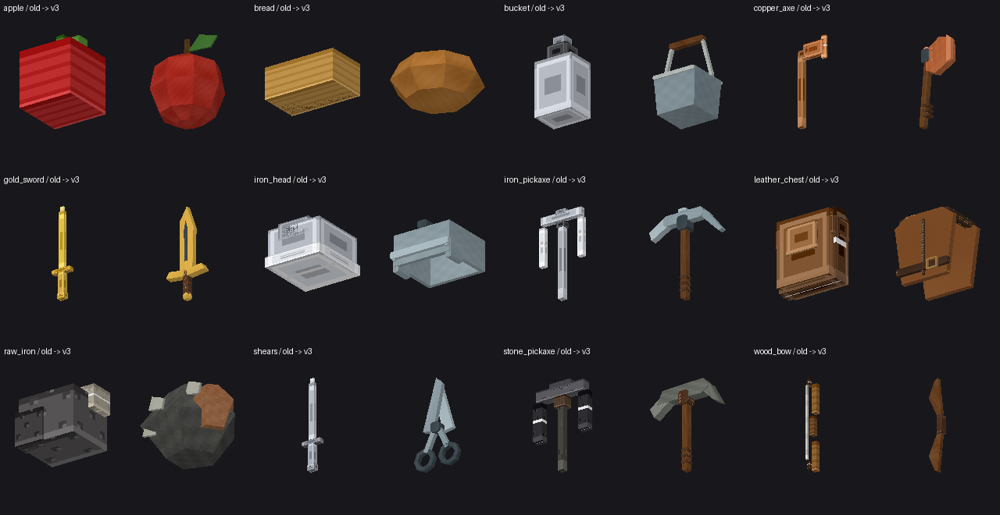
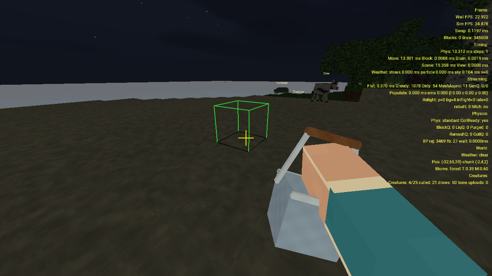
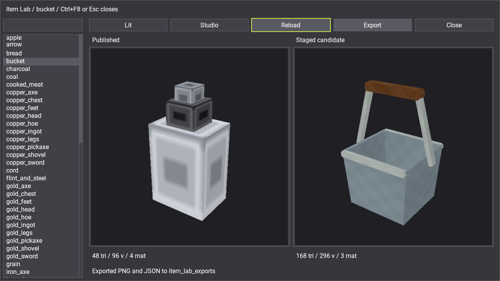
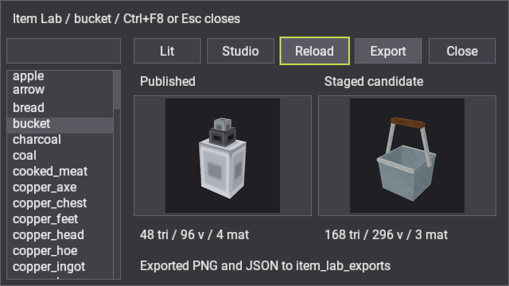
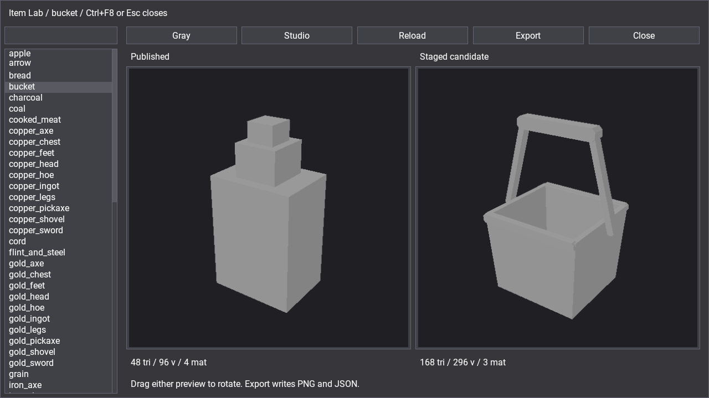

# Item visual redesign — implementation record

Branch: `codex/item-visual-redesign`, based on develop `946ef5f2d`.

Status: **in progress; production acceptance has not been reached**.

## Fixed design

All 70 items retain their IDs, crafting, statistics, finite ownership, physics and
throw rules. Faceted handcrafted forms, authored painted surfaces and gentle
lighting. Original meshes, UVs and pixels; reference assets remain references.
Generator plus preserved author overrides. Item Lab is an in-game inspection
screen, not a modelling or painting application. Only existing gameplay states
drive animation: bow, shears, containers and use transitions.

## Baseline

`baseline.json` preserves all 70 definitions, active declared model paths,
attribution records, triangle counts, texture sizes and identical geometry groups.
These are declared disk resources, **not a runtime resource-resolution trace**.
Existing production assets are deliberately unchanged at this checkpoint.

## Implemented foundation

- Independent `itemgen.mesh` surface representation, convex profile extrusion,
  XY corner bevels, open thick-walled shells, rotation about pivots and taper.
- Outward CCW faces and independent flat-shaded triangles with unit normals.
- `itemgen.surface_uv` deterministic per-surface orthonormal projections,
  explicit texel density and 128/256/512 atlas budgets with four-pixel gutters.
  Overflow and duplicate surface names fail rather than silently scaling UVs.
- Eight meaningful geometry/UV regressions cover winding, shell cavity,
  degenerate geometry, bounds, pivots, packing, overflow and repeatability.

The new surface path is connected to a separate staging exporter through
`python tools/itemgen.py build-design --id bucket`. It writes real NORMAL,
POSITION and TEXCOORD_0 attributes, indexed triangles, glTF material parameters,
an explicit mipmapped sampler and a per-face UV layout. Layered surface painting
supports material-specific broad variation and read-only authored RGBA overlays
under `tools/item_designs/<id>/surfaces/<surface-name>.png`. Wrong overlay sizes
fail rather than stretching an author's work. Gutters include corner dilation.

The first bucket prototype has an open vessel, separate rim, raised handle and
wooden grip. It is fitted uniformly into the unchanged physical envelope. This
prototype is not yet a finished artistic pilot or a production replacement.



Three additional staging/export regressions verify actual normals, raster
round-trip, unchanged physical bounds, determinism, read-only overlay application
and rejection of unsafe staging destinations. The existing raster reader was
fixed to handle a valid glTF material with an omitted baseColorFactor; its integer
default previously failed during floating-point texture multiplication.

Validation at this checkpoint: 11 new geometry/UV/design tests, four existing
raster tests and two publication tests pass. Style/include checks pass. The
profiled acceptance runner now includes the three new test scripts.

## Runtime surface checkpoint

Added independent item CPU/GPU representations without changing creature vertex
buffers or creature shaders. The strict loader preserves hierarchical node
transforms, unit normals, UVs and material factors; rejects escaping paths,
truncated/oversized/invalid accessors, missing normals, cyclic/shared nodes,
invalid scale and unsupported primitive modes. A Release C++ test covers the
interleaved accessor stride, material values, composed bounds, parent-pose
inheritance and returning to the authored pose after cancellation.

`ItemSurfaceRenderer` uploads each immutable primitive once and retains its
owner while the VAO exists. The shader performs linear-light diffuse shading,
a restrained metallic/roughness-dependent highlight and display conversion.
It supports a presentation light profile and fog; albedo gets mipmaps. Cache
clearing and GL cleanup are explicit. Icons/previews and FP now dispatch v3
assets through this path; legacy resources retain the previous renderer.

Native probes temporarily substituted **only the runtime copy** of the staged
bucket, restored the original three files in a finally block, and ran the
Release executable through flight_sim_run.py on CarryAimQA. Production sources
and the publication manifest were not replaced.

- Full checkpoint regression: 22 Release CTest tests and native gameplay,
  ownership, player window and 132 icon checks passed, including bucket in mixed
  slots and recovery. This proves the connected icon path runs in a real GUI.
- A separate presentation-only FP probe uses `CUBA_FLIGHT_QA_FP_ITEM=bucket`;
  it neither equips nor consumes saved property.
- The FP image exposes an unfinished grip: the inherited waterskin-era pose
  places the hand inside the vessel. The bucket is **not accepted as a finished
  pilot**. Authored contact anchors and appropriate framing remain required.
- World lighting of FP, TP/armor/ground integration, gameplay-driven state
  binding, imported authored meshes and Item Lab are still pending. No claim of
  a performance-budget pass or full native visual acceptance is made.




Checkpoint logs/reports are in [surface-checkpoint](surface-checkpoint/).

## Pilot construction and contact checkpoint

There are now **12 authored v3 candidate sources; 0 production replacements**.
All 70 gameplay definitions and the canonical production manifest remain unchanged.
The candidates cover both picks, copper axe, gold sword, iron helmet, leather
chest, bow, bucket, shears, apple, bread and raw iron. Construction and unresolved
art gates are recorded in [pilot cards](../../../tools/item_designs/PILOTS.md).

New mesh capabilities include faceted ring-built solids and genuinely hollow
finger loops. UV packing now reuses free rectangles rather than wasting the
space beside long shafts; density and texture dimensions remain explicit.
Authored source seeding preserves existing files. Optional named nodes have
hierarchical pivots and part-local geometry; tests compare reconstructed rest
surfaces before and after grouping to ensure the model does not move.

Authored right/left contact points follow the same physical fitting as the mesh.
FP pose, scale, hand-root offset and arm rotation are independent of world size.
Arm rotation pivots around the palm, preserving the contact point. The bucket's
handle has more clearance; its mesh is no longer centred through the hand.
The FP view was iterated with actual screenshots, not accepted from unit tests.
The icon camera has a separate rotation, used to reveal the bow's curved plane.

The surface cache now observes content revisions; FP clears owned GPU geometry
on resource reload. A Release regression verifies a cached legacy dispatch can
be replaced by a declared v3 resource after the revision changes.

`tools/run_item_design_probes.py` builds staged designs, temporarily substitutes
runtime resources, runs Release native checks on a QA world, captures an FP
probe and restores every runtime file. Dedicated regressions cover restoration
after a probe exception and after partially missing staging data. `--fp-only`
is explicitly a narrower presentation probe, not a full regression pass.

The full run passed **22 Release CTest tests and 202 icon checks**, including
all 70 catalog items. It also checks the runtime catalog against the item
storage's complete catalog IDs. Twelve candidates were substituted for this
probe; the other 58 items retained their previous production graphics. FP probes
are synthetic presentation inputs and do not equip or consume player property.
Style/include/format checks and the geometry/design/probe test suites pass.




Evidence: [native result](pilot-checkpoint/native-result.json),
[icon coverage](pilot-checkpoint/icons.json),
[Release tests](pilot-checkpoint/ctest-release.log),
[Release build](pilot-checkpoint/desktop-release.log),
[probe summary](pilot-checkpoint/design-probe.json).

This checkpoint is not artistic acceptance of all twelve: bread scores still
need surface work, armor needs both-body motion/fit verification, bow/shears
need gameplay-driven node poses, and containers need visible fill. Item Lab,
world/TP/armor/carry integration, author glTF import, versioned publication,
the remaining 58 designs and comparative performance gates are still required.

## Native Item Lab checkpoint

The read-only orbit comparison studio opens with **Ctrl+F8**, preserving the
existing F8 weather action. It lists all 70 item IDs and renders published and
staged resources side by side with synchronized rotation. Seven actual-mesh
modes are available: lit, silhouette, gray material, albedo, UV checker, normals
and wireframe. Ambient-light presets, triangle/vertex/material costs, explicit
missing-candidate messages, PNG/JSON export and resource reload are implemented.
The studio does not equip items, consume stacks or write player property.

Reload clears inspection geometry and GPU resources, surface/texture caches and
notifies game item caches through the item content revision. Icon warmup drops
stale entries and bypasses the previous disk images after invalidation. Strict
production validation remains intact: computed normals are permitted only for
legacy inspection, never for a declared v3 candidate. The loader regression
covers both cases. Failed loads clear the previous image instead of displaying
a stale successful selection.

Native inspection found overlapping list text at 200% scale. List row height
now follows the scaled theme during layout; the native layout audit checks it
in addition to widget bounds. All six 1280x720 / 1920x1080 and 100/150/200%
combinations were captured; the limiting 1280x720 / 200% case was visually inspected.
The final studio run passes **104 checks**, including all 70 published previews,
seven candidate modes, captures, real routed pointer switching, export, reload,
closing and unchanged serialized inventory. The seven candidate preview crops
have distinct pixel hashes; both exported images are 512x512.

The general acceptance runner now stages all authored candidates and requires
the studio report alongside the existing native reports. The full regression
passes **22 Release CTest tests**, **202 icon checks**, 51 gameplay checks,
57 ownership checks, 18 ownership UI checks and seven player-window checks.
After the final label sizing adjustment, the 104-check studio run was repeated
on the rebuilt Release executable. Style, include and clang-format checks pass.





Evidence: [summary and source hashes](item-lab-checkpoint/summary.json),
[full native regression](item-lab-checkpoint/native-result.json),
[final studio checks](item-lab-checkpoint/lab-final.json),
[Release tests](item-lab-checkpoint/ctest-release.log),
[Release build](item-lab-checkpoint/desktop-release.log),
[studio authoring guide](../../../tools/item_designs/ITEM_LAB.md).

This is an initial studio, not completion of the visual plan: twelve authored
candidates exist and **zero production models have been replaced**. FP/TP/ground
and both-body armor lab scenes, gameplay-state controls, contact/bounds overlays,
small-icon inspection, author glTF import, publication, the remaining 58 designs
and comparative performance acceptance are still required. Flight metrics were
disabled for these correctness runs; no p95 or memory-budget claim is made.

## Remaining implementation, in order

1. Native baseline and actual resource-path trace, before/after references and
   individual design cards. No claim of direct Luanti mesh copying is established.
2. Finish the versioned design adapter and surface glTF exporter with animated
   nodes/pivots, manual glTF import and preserved authored overrides.
   Build to staging; validate and publish separately; preserve sidecars and layers.
3. Surface-space painted layers and authored overlays: base, broad variation,
   construction detail, manufacturing marks. 128 small materials, 256 hand items,
   512 armor. Albedo and optional standard metallic/roughness parameters.
4. Complete the item-only path across TP/armor/ground/carry and wire world
   light, gameplay state and authored contacts. The data types, shader and
   icon/FP dispatch exist, but have not met full presentation acceptance.
   Leave creature buffer ABI and creature shaders unchanged.
5. In-game Item Lab: catalog, old/new, fixed/orbit cameras, silhouette/gray/albedo/
   lit/UV/normals/wireframe, 32/48/64 icons, FP/TP/ground, both body types, states,
   anchors/bounds/cost, reload with cache invalidation, PNG/JSON export. Synthetic
   instances must not mutate saved player property.
6. Twelve pilots: stone_pickaxe, iron_pickaxe, copper_axe, gold_sword, iron_head,
   leather_chest, wood_bow, bucket, shears, apple, bread, raw_iron.
7. Remaining models in waves: tools/weapons, utilities/containers, armor,
   food/materials. Remove unrelated family aliases and color-only armor tiers.
8. Full native visual audit and performance acceptance. No final completion
   checkbox until every item and gameplay representation has evidence.

## Acceptance contract

Deterministic publication preserves author work and grips. Missing production
assets fail acceptance instead of substituting a cube. No accidental UV mirror,
bleeding or stretched tiles. Item state cancellation restores the correct pose.
Two hands, throws, pickup and armor motion retain ownership and gameplay state.

Triangle caps: 1200 hand items, 1800 compound utility/bow, 2000 armor slot,
600 food/material; no minimum count as a proxy for beauty. Measure cold catalog,
texture memory, FP, equipped characters and 512 bodies; p95 >10% over the same
baseline scene requires optimization. Capture 1280x720 and 1920x1080 at
100/150/200%, day/night/interior. Review all 70 contact sheets and native views.

Only Release desktop:

```
cmake --build build/desktop-msvc --config Release --target Cubatarium --parallel 8
python tools/test_itemgen_mesh.py
python tools/test_itemgen_surface_uv.py
```

World loading and native checks must use `tools/flight_sim_run.py` with
`bin/Cubatarium.exe` on isolated QA worlds. The foundation tests are not native
visual acceptance. Full ownership/equipment/throw regressions remain mandatory
when the new runtime path is connected.
