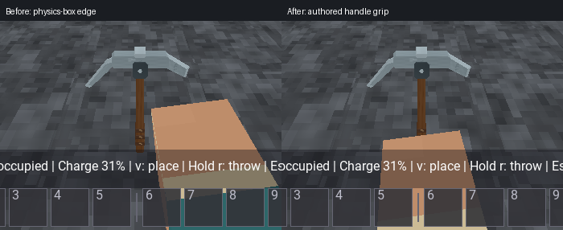

# Routed item carry/throw input and FP grip correction

The real-world fixture now routes R, Escape and V through
`UApplication::RouteKey`, the same application handler used by the window.
It does not assign the charge, occupancy or ownership result itself. Timed game
ticks advance charge and resolve physical motion. Cases use synthetic finite
property on the restored `ItemVisualPerfQA` world, including worn durable items
and filled bucket/waterskin instances. These are application-routed events,
not OS keyboard injection. Fixture controls are fixed temporarily and restored.

Both Creative and Survival pass all 70 IDs, eight stages per item:
equipped, windup, canceled, placed, grabbed, rewound, released and landed.
Each mode produces 560 native frames and 2824 checks. Exactly one finite unit,
its instance ID, wear, broken flag and contents survive every transition.
Survival fixture fatigue resets between independent cases. Immediate release
checks a real nonzero impulse; later frames verify continued ownership and
support. The first broad run wrongly required a body still to be flying at the
first delayed screenshot; a short ground contact can already end that flight.
The corrected assertion checks the key event before collision resolution.
The rejected timing report is retained, not counted as acceptance.

## Actual presentation correction

The first input-driven screenshots exposed a floating right hand next to the
iron-pickaxe shaft. FP carry had targeted the physical box's side rather than
an authored grip. One-handed typed items now query the authored right grip in
the same centred local transform used by `SubmitLoose`, including world ground
scale. Legacy/block/creature handling and two-hand fallback remain intact.
No geometry, physical size, mass, throw speed, definition, balance or ownership
rule changes. FP arm length/scale stays unchanged.

The native FP audit reads the actual rendered arm/palm matrix. Its projected
palm agrees with the supplied contact within 2.4e-7 NDC in the all-item runs.
A separate 70-item presentation regression compares the helper's contact with
the observed actual loose draw transform, including translation, rotation and
scale. This establishes projection and transform agreement, not finger wrapping
or anatomical validity of a generic two-hand target.

## Open visual defects discovered by the new coverage

The front-camera diagnostic exposes the old TP carry layer: hands rise near
the face while the physical item is at belt height. This is visibly wrong and
is not fixed by the FP correction. Also, the generic two-hand box targets do
not suit the stone/wood pickaxe shaft; filled-bucket hands obscure the vessel.
The supplied target and palm can numerically agree while the chosen target is
artistically wrong. Those cases therefore remain open despite green mechanical
checks. `tp-pose-open-defect.png` and `two-hand-grip-open-defect.png` retain them.
The 24-frame TP run proves routed transitions and records diagnostic positions;
it does not certify TP pose quality.

The next presentation pass must provide authored carry-specific contacts for
both hands and a shared carried-model transform, then correct the human upper
body with reachable arm targets. It must preserve physical profiles and release
rules. Derive pose targets from the authoritative carried body; do not create
inventory copies, move collision bodies to hide visual gaps or stretch arms to
force a passing contact assertion. Recheck both body forms, aiming from the
ground upwards, containers, two-hand tools and held creatures. Actual
mouse-driven bow/use/cancel transitions remain separate.

## Retained evidence and regression

`frame-hashes.json` signs all 1120 flow PNGs. `selected-native-frames.zip` retains
115 original flow PNGs: all 70 Creative windups and full eight-stage flows for
iron_pickaxe, iron_chest and filled waterskin in both modes. It also retains all
24 diagnostic TP frames. The other raw flow PNGs remain in the ignored local
`bin/item_world_visual` outputs; they are not claimed to be in this archive.
`native-output.zip` retains every flow report/request/flight, exact tested source
bytes, before-correction samples and source files, rejected timing evidence,
Release/audit outputs and integrated results. No exposure/color changes were
made to the retained PNGs; the side-by-side figure is an unscaled native crop.

The exact Release build passed, followed by 25 CTests and the complete staged
native regression: gameplay 59, ownership 57, ownership UI 18, player window 7,
icons 209, Item Lab 1040, presentations 3660, and the window profile. Temporary
runtime substitutions were restored. Style, include-boundary and format audits
passed. CI now offers the same two-mode routed-key profile in the optional
native job, checks every exit code and retains artifacts; remote execution is
not evidenced locally.

Production promotion remains 0/70. Authored two-hand/TP carry, actual use/bow
transitions, final provenance/publication, complete final display matrix and
performance acceptance remain. This checkpoint does not complete the goal.
