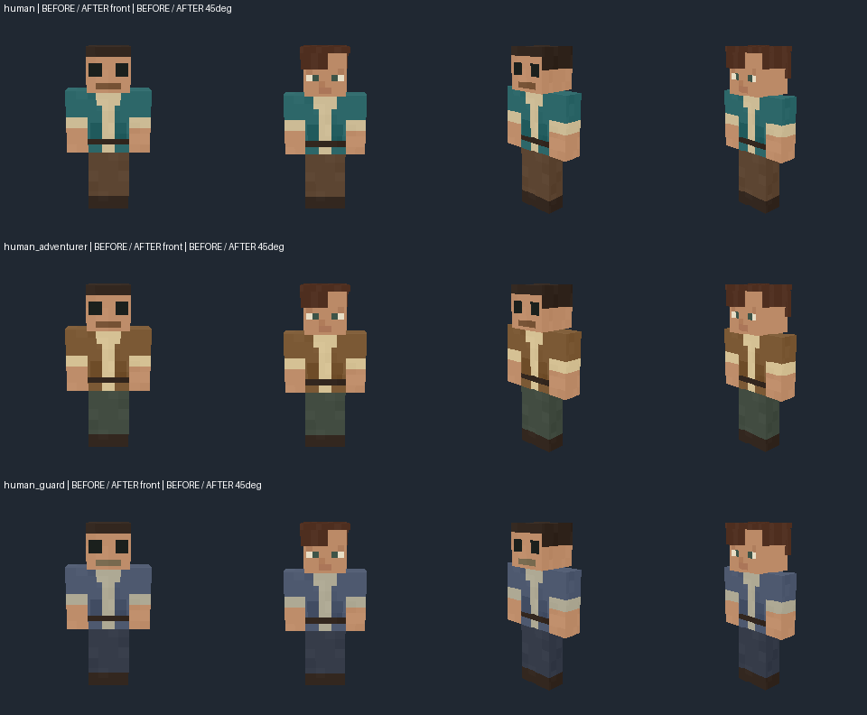
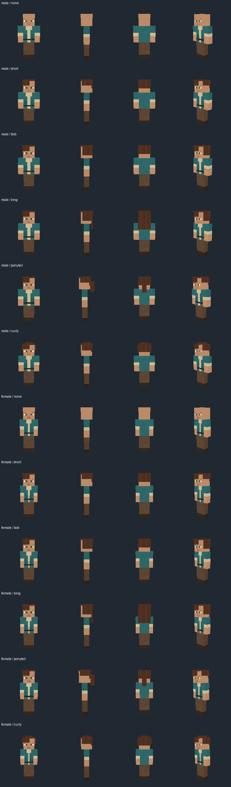
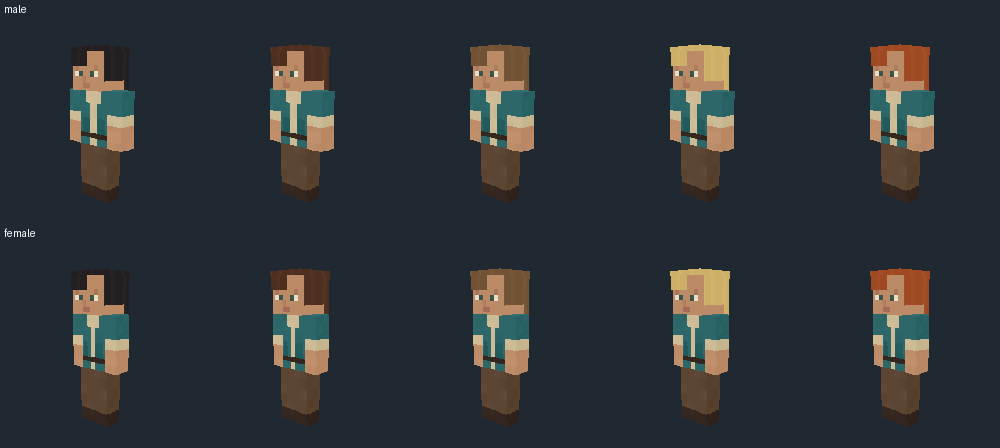
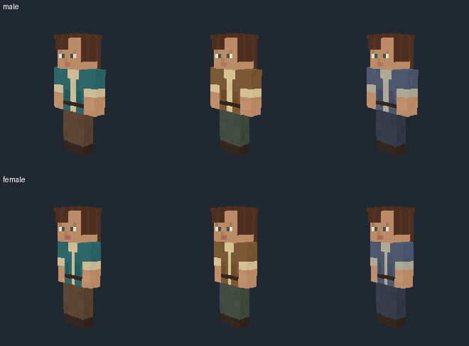
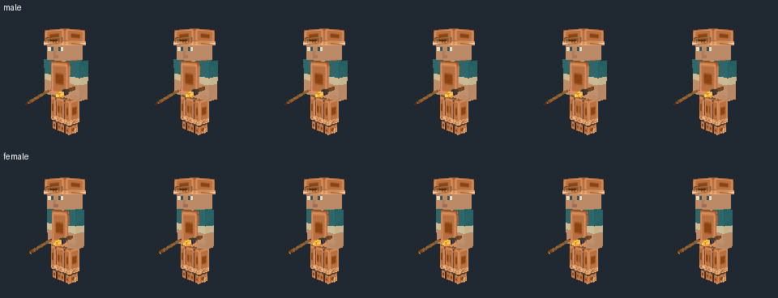
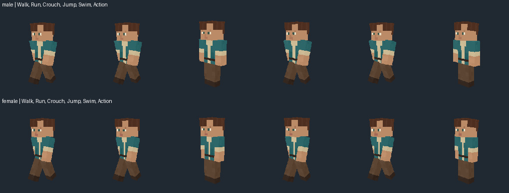
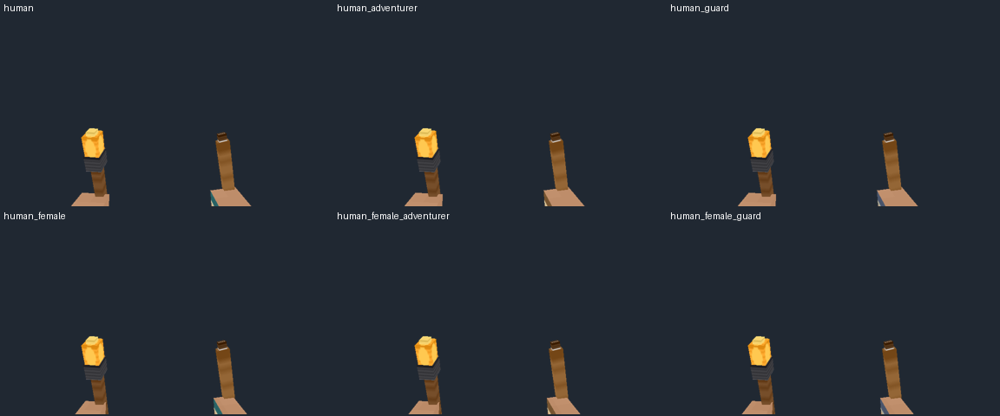
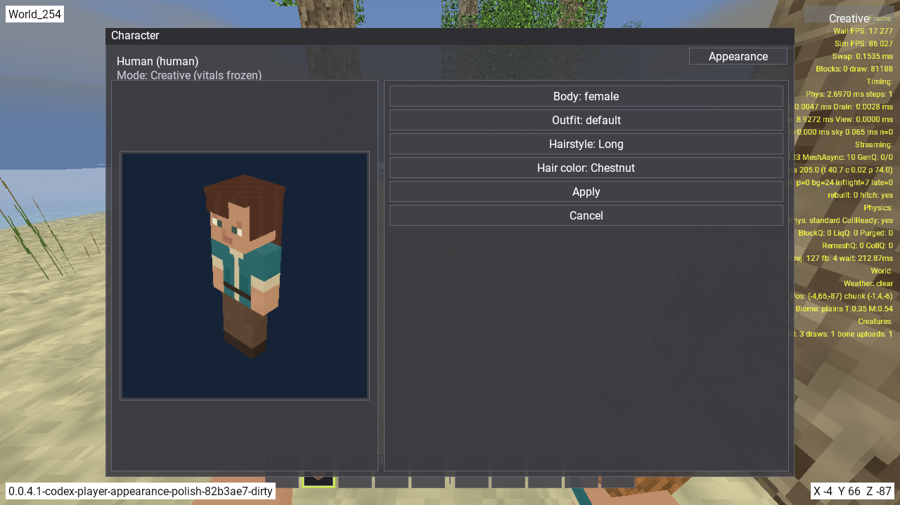

# Игрок: внешний вид и независимые настройки — 13 ноября 2026

Этап реализован в `codex/player-appearance-polish` от `origin/develop` (`2b0866352`).
Код и ресурсы: `eabc3c837`; быстрые исправления: `970925d5d`.
[Принятый план](../../PLAYER_APPEARANCE_PLAN_2026-11-13_RU.md).

## Что изменилось

Лицо получило небольшие глаза со светлой частью и зрачком, спокойные брови, нос
и аккуратный рот. Сохранены блочная голова, рост, точки костей, камера и физика.
Мужской и женский варианты имеют обычный и узкий силуэты. Шесть причёсок
(без волос, короткая, каре, длинная, хвост, кудрявая), пять цветов волос и три
варианта одежды выбираются независимо: всего 180 сочетаний.
Геометрий 12, атласов 30; цвет и одежда не размножают меши.

Открыть окно персонажа клавишей C, выбрать **Appearance**, нажимать селекторы
**Body**, **Outfit**, **Hairstyle**, **Hair color**. Preview можно вращать.
**Apply** применяет и сохраняет выбор, **Cancel** отменяет черновик.
Под шлемом волосы скрываются; при управлении другим видом настройка скрыта.
Руки FP и игровой персонаж используют те же выбранные геометрию и атлас.
Отсутствующие/неизвестные параметры дают male/short/chestnut.

Старые texture-only паки с diffuse.png используют базовую геометрию и UV.
Новые согласованные наборы атласов разрешают настройку внешности. Кеши учитывают
выбор и пересоздание каталогов; missing asset не оставляет новый меш со старым UV.
Исправлены сапоги copper/gold/iron/leather: удалён legacy offset поверх
подгонки bone_volume, fitting поножей и обуви учитывает четыре слота инвентаря.
Обувь больше не висит ниже стоп; генератор сохраняет исправление.

Новые ресурсы имеют отдельный appearance_manifest.json с source hashes,
версией toolchain и хешами каждого файла. Старые обзоры и общие генераторы
не изменены; прежние payload всех остальных существ и базовые fallback-ресурсы
сохранены побайтно.

## Проверки

- Release Cubatarium: PASS; verify-windows-exe: PASS (6 системных DLL).
- Player generator: 4/4, включая повторную генерацию и 180 геометрия/атлас пар.
- Общий generator quality: 13/13.
- Генератор экипировки: 1/1, повторная генерация сапог четырёх материалов.
- CreatureEquipmentFit C++: PASS — действующие slots legs=2/feet=3, подошва и стык поножей.
- CreatureAppearance C++: PASS — 60 сочетаний параметров, старые и ошибочные поля,
  missing atlas, legacy/new texture-only overlays и инвалидация revision.
- Native visual: 126 кадров внешности и поз; все непустые и без обрезания.
  Все шесть причёсок в полной броне с мечом и факелом дают одинаковое изображение для каждого тела: волосы скрыты.
- FP: 12 ресурсов, 1248 кадров, PASS; bare/main/off/dual, idle/walk/attack,
  CPU/GPU arm-buffer identity, сохранение inventory и user selection.
- Native entity save: 128 случаев LoadCreatures/SaveCreatures/reload, PASS;
  в том числе женская внешность long/ginger для human и его двух скинов.
- Editor QA: реальные кнопки, Apply/Cancel, изоляция черновика, preview, запись
  пользователя через SaveUsers и доступность элементов в раскладках
  1280×720 и 640×480 — PASS. Исходный выбор после теста восстановлен.
- Fidelity: **35/37**. Lobster и отдельная проверка всех шагов Orc проходят;
  остаются реальные Treeman/Orc contact findings. Строгие допуски сохранены.

Доказательства: [verification.json](verification.json),
[native_image_audit.json](native_image_audit.json), [UI QA](ui_qa.json),
[быстрые исправления](QUICK_FIXES_RU.md), [остатки](BACKLOG_RU.md),
[измерения в мире](creature_stance_world_diagnostics.json), `checks/`.
При сравнении исходного/нового визуала EXE различаются: это художественное
сравнение, а не доказательство побайтовой эквивалентности двух рендереров.
Матрицы FP/save и preview не заменяют весь terrain/camera/cooperative/Android
или performance audit. Метрики flight в этих запусках отключены.

## Просмотренные native-листы










## Повторение

```powershell
python tools/generate_player_appearance.py
python tools/test_player_appearance.py
python tools/test_player_equipment.py
python tools/test_creaturegen_quality.py
python tools/test_creaturegen_fidelity.py
cmake --build build/desktop-msvc --config Release --target Cubatarium --parallel 8
```

Последняя fidelity-команда сохраняет два известных падения, описанных выше.
Для native QA всегда выбирать новые label/native-dir: старые результаты
не перезаписываются. Из корня репозитория:

```powershell
$env:CUBA_PLAYER_APPEARANCE_QA='1'
$env:CUBA_PLAYER_APPEARANCE_UI_QA=(Join-Path (Get-Location) 'docs/research/player-appearance-2026-11-13/ui_qa.json')
python tools/research/run_creature_pilot_qa.py --production --species badger --preview-species human --out docs/research/player-appearance-2026-11-13 --label rerun --native-dir native_rerun --matrix --fp-matrix --save-probe --seconds 5 --capture-interval 1
python tools/research/review_player_appearance.py --root docs/research/player-appearance-2026-11-13 --native native_rerun
```

World actor — badger: human помечен non-spawnable; preview/FP/editor отдельно
проверяют human. Базовый мир — World_254. UI QA восстанавливает исходный выбор;
entity save-probe использует изолированные окружения.

В Git сохраняются листы, выбранные source-native PNG, отчёты, контексты и логи.
Bulk FP/framebuffer matrices, промежуточные запуски и файл с тестовым снимком
пользователей остаются локально под .gitignore. Для пересоздания всех кадров
использовать приведённые инструменты.
